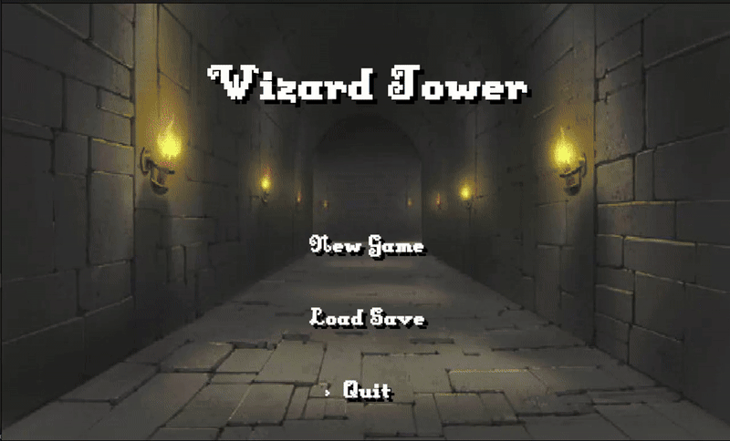
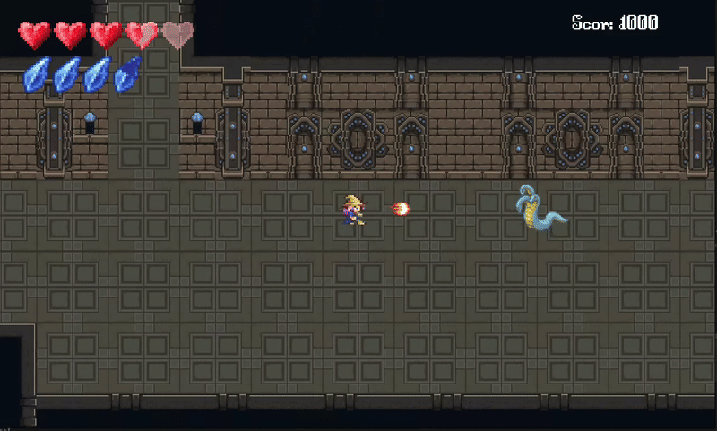
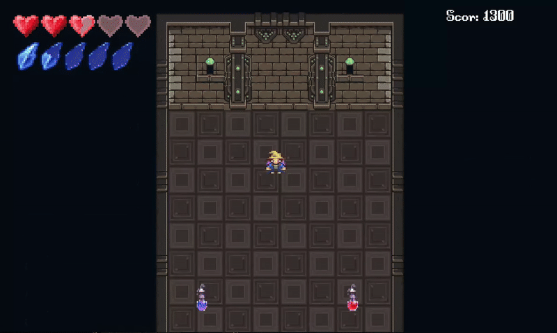
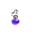
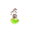

#  🧙‍♀️ Wizard Tower
A 2D dungeon-crawler game with RPG elements where you ascend a mystical tower, unlocking magical abilities and battling enemies to save imprisoned wizards.

## Story
Zeleea, a curious and rebellious teenager, visits her grandparents during summer vacation. Her grandfather has always amazed her with magic tricks, but some tricks remain mysterious. While exploring the attic, she discovers a chest containing a blue robe, a wizard's hat, and a mysterious leather-bound book with a tower embroidered on its cover.
As she browses through the dusty volume, a golden tapestry begins to emanate a purple light. Suddenly drowsy, Zeleea falls into what feels like a lucid dream, finding herself in an empty green field with only a tall tower in the distance. With nowhere else to go, she approaches the tower and opens its weathered wooden door, stepping into the unknown...

##  About

This project was my first major university project, developed for the Object-Oriented Application Design course. It marked my first introduction to Java and object-oriented programming, presenting both a challenging learning curve and an exciting creative opportunity.
What started as an academic requirement quickly became a small passion project. Despite being my first experience with Java, I fell in love with the development process and the world I was creating. Wizard Tower holds a special place in my heart, and I'm committed to continuing its development in my free time, expanding it beyond its original scope into a more polished and feature-rich game.
This project taught me fundamental concepts including object-oriented design, game loop implementation, sprite animation, collision detection, state management, and resource handling - all while bringing Zeleea's magical adventure to life.

##  Gameplay

**Wizard Tower** is a top-down dungeon-crawler game where you control Zeleea through a mystical tower, ascending floor by floor. Each level presents a labyrinth filled with enemies, potions, Wizard NPCs and a key you have to find in order open the door to next level.

### Gameplay preview
 

<b>Getting Started</b>

  

<i>Main menu, movement, and first Wizard interaction</i>

   

 <b>Combat & Spells</b> 

  

 <i> Fire and Ice magic in action against enemies </i> 

   

 <b>Consumables & Boss Teaser</b> 

  

 <i>Using health and mana potions before facing the final challenge</i> 

   

### Core Mechanics

- **Exploration**: Navigate maze-like levels searching for imprisoned wizard masters and resources 
- **Combat**: Use melee attacks and unlock magical abilities (Fire and Ice spells)
- **Resource Management**: Manage your Health Points, Mana and Speed and upgrade them through potions scattered around the tower
- **Progression**: Defeat enemies, collect items, and unlock new abilities
- **Atmospheric audio**: Immersive soundtrack and sound effects enhance the magical atmosphere

### Controls

| Key | Action |
|-----|--------|
| W, A, S, D | Move (Up, Left, Down, Right) |
| Y, U | Select and cast projectile spells |
| ENTER | Melee attack / Interact with NPCs |
| ESC | Open menu |

### Game Features

- **3 Unique Levels**: Each floor introduces new enemies and challenges
- **Magic System**: Unlock Fire and Ice abilities by freeing wizard masters
- **Consumable Items**: Collect potions for health, mana, and speed boosts
- **Boss Battle**: Face a powerful final enemy on the third floor
- **Save System**: Save your highscore and try to beat it next time

##  Future updates
Planned Features:

-  Score System Improvement: Collectible gold coins/objects to increase your score
-  Dynamic Lighting: Torch system and lighting effects for enhanced atmosphere
-  Spell UI Icons: Visual indicators on the HUD showing unlocked spells (similar to ability bars in other games)
-  General Polish: Overall game refinements and UI/UX enhancements for a smoother player experience
-  English Translation: Change game language from Romanian to English
-  Itch.io Release: Publish the game on itch.io for easier accessibility
-  Android Port: Potential mobile port depending on available time

## Where to play

**Coming Soon!** The game will be available to play once development is complete and published on [itch.io](https://itch.io).

**Important:** Due to file size limitations, the resources folder is not included in this GitHub repository. The game will be fully playable once it's released on itch.io with all assets included.

  
  
  

